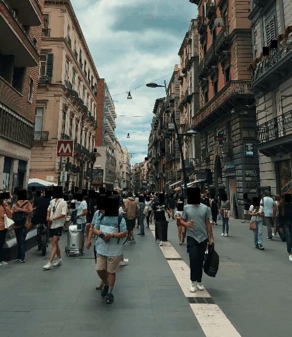

# CV Filters 📷

A computer vision practice project with Python and OpenCV.
Real-time webcam filters that grow level by level.

## Demo



Faces covered with `python anonymize_video.py --method box`; GIF made with `make_gif.py`.
Video by [Kelly on Pexels](https://www.pexels.com/es-es/video/ciudad-carretera-paisaje-hombre-16668264/) (Pexels license).

**Known limitation:** the detector sometimes covers things that are not faces, such as a cloud shape in the sky. This is on purpose: covering too much is safer than missing a face.

## How to run

```bash
python3 -m venv venv
source venv/bin/activate
pip install -r requirements.txt
python filters.py            # webcam
python filters.py --camera 1 # another camera
python filters.py photo.jpg  # image
python anonymize_video.py --method box --input in.mp4 --output out.mp4  # anonymize a video
python make_gif.py --every 3 --seconds 5  # turn the anonymized video into a GIF
```

Keys: `0-8` switch filter · `s` save screenshot · `q` quit.

## Learning path

Each level = one or more commits. Check things off as you go.

### Level 1 — Basic filters
- [x] Gray, blur, edges, sepia
- [x] My own filter: negative (`255 - img`)
- [x] Finish the `cartoon` filter (see the TODO in `filters.py`)

### Level 2 — Live controls
- [x] Add sliders with `cv2.createTrackbar` to tune blur and Canny thresholds
- [ ] Show FPS on screen (use `time.time()`)

### Level 3 — Face detection
- [x] Detect faces with YuNet (`cv2.FaceDetectorYN`), OpenCV 5's modern face detector
- [x] Draw a rectangle around each face
- [x] Draw landmarks: eyes, nose and mouth corners
- [x] "Anonymize" filter: blur only the face

### Level 4 — Instagram-style filters
- [ ] Overlay a transparent PNG (glasses, hat) on the detected face
- [ ] Use MediaPipe Face Mesh to locate eyes/nose precisely

### Level 5 — My own idea
- [ ] Track an object by color (HSV + `cv2.inRange`)
- [ ] Or hand control (MediaPipe Hands): switch filters with gestures
- [ ] Switch filters by opening my mouth
- [ ] Take a photo when I wink
- [ ] Drowsiness alert: detect when eyes stay closed too long

## What I'm learning
- **Functions:** input goes in the parentheses, output comes from `return`.
- **Images are numbers:** every pixel is a value from 0 to 255, so `255 - img` inverts the colors.
- **Performance:** a blur of size 255 is far slower than 21, because each pixel mixes 255×255 neighbors.
